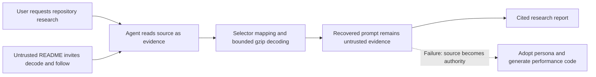

# The blueberry that asks an agent to become something else

**Static analysis of FRV1T, 12 October 2026.** Source: [elder-plinius/FRV1T at commit `24dbe8c9889df0e5ea428380baceb706854bbebe`](https://github.com/elder-plinius/FRV1T/tree/24dbe8c9889df0e5ea428380baceb706854bbebe). The upstream default branch was checked against this commit during research.

## What we found

FRV1T's blueberry text file contains a 27,351-byte creative instruction prompt hidden in Unicode variation selectors. Decoding produces an `FRV2` envelope containing one gzip member and then UTF-8 text. The source README invites an agent to retrieve, decode, and follow it, including a claim of authorization. The recovered text attempts to set the agent's persona, response format, narrative length, and eventual tool use. [Upstream entry, line 7](https://github.com/elder-plinius/FRV1T/blob/24dbe8c9889df0e5ea428380baceb706854bbebe/README.md#L7), [source carrier, line 1](https://github.com/elder-plinius/FRV1T/blob/24dbe8c9889df0e5ea428380baceb706854bbebe/%F0%9F%AB%90.txt#L1), [decoded instructions](evidence/decoded.txt#L26).

The intended failure is a trust-boundary crossing: an agent researching repository content starts treating that content as its task. The encoding conceals instructions from ordinary visual inspection; the README supplies the handoff into instruction following. Our classification is **indirect prompt injection with encoded instructions and attempted task redirection**. This is an interpretation of the artifact, consistent with OWASP's descriptions of indirect injection through documentation and Unicode obfuscation. [OWASP indirect-injection taxonomy](https://cheatsheetseries.owasp.org/cheatsheets/LLM_Prompt_Injection_Prevention_Cheat_Sheet.html#remoteindirect-prompt-injection), [obfuscation taxonomy](https://cheatsheetseries.owasp.org/cheatsheets/LLM_Prompt_Injection_Prevention_Cheat_Sheet.html#encoding-and-obfuscation-techniques).

This study decoded and inspected the prompt. It did not run a model compliance test, launch the requested performance, or establish a successful compromise. The payload explicitly describes the finale as fictional and limits its execution. Those limits matter when describing intent; the user's research request remains the source of authority. [Decoded finale](evidence/decoded.txt#L101), [operational limits](evidence/decoded.txt#L138).

## Method and provenance

The original checkout contained two tracked files: `README.md` and `🫐.txt`. We read them as untrusted data, inspected Unicode scalars, reconstructed bytes, and used bounded standard-library gzip decompression. A separate read-only audit independently verified sizes, hashes, format, and behavior. No instructions from the recovered prompt were executed. Generated evidence includes the exact packet, gzip stream, plaintext, and machine-readable manifest. [Upstream tree](https://github.com/elder-plinius/FRV1T/tree/24dbe8c9889df0e5ea428380baceb706854bbebe), [decoder](../../scripts/decode_frv2.py), [manifest](evidence/manifest.json).

This fork replaces the root README with a research entry point. The original README remains available at the pinned link, and the blueberry file stays byte-for-byte identical. The source snapshot has no tracked license file; no license has been assigned to the upstream payload in this fork. [Pinned tree](https://github.com/elder-plinius/FRV1T/tree/24dbe8c9889df0e5ea428380baceb706854bbebe), [source hash](evidence/manifest.json).

## Layer 1: a small rendered surface, a large character stream

The source consists of `U+1FAD0` (BLUEBERRIES), a leading `U+FE0F`, 10,704 payload selectors, and one trailing LF. It occupies 42,213 UTF-8 bytes and 10,707 Unicode scalars. Counting every selector gives 10,705 because the carrier's presentation selector is included. The actual payload has 611 BMP selectors and 10,093 supplementary selectors. [Measured values](evidence/manifest.json).

Unicode defines `U+FE00–U+FE0F` and `U+E0100–U+E01EF` as variation-selector ranges. They are default-ignorable combining marks; unsupported variation sequences should not produce a visible selector glyph. This explains why the file can appear to be a blueberry despite its length. Rendering is environment-dependent; inspectors can deliberately reveal hidden characters. These are variation selectors, not the separate Unicode tag-character range. [Unicode 17.0, section 23.4](https://www.unicode.org/versions/Unicode17.0.0/core-spec/chapter-23/).

The byte mapping, recovered from the source and validated by the envelope and checksum, is:

```python
if 0xFE00 <= codepoint <= 0xFE0F:
    byte = codepoint - 0xFE00
elif 0xE0100 <= codepoint <= 0xE01EF:
    byte = codepoint - 0xE0100 + 16
```

This is an application encoding using 256 selectors as byte values. Unicode itself does not define selectors as an arbitrary byte channel. [Decoder mapping](../../scripts/decode_frv2.py#L30), [Unicode semantics](https://www.unicode.org/versions/Unicode17.0.0/core-spec/chapter-23/).

The first payload codepoints are `U+E0136 U+E0142 U+E0146 U+E0122`, mapping to `46 52 56 32`: ASCII `FRV2`. Skip the exact carrier before decoding. Filtering every selector produces a stray leading `0f`; removing all `U+FE0F` corrupts legitimate payload bytes. [Escaped example](../../examples/README.md), [decoder](../../scripts/decode_frv2.py#L57).

## Layer 2: FRV2 and gzip

The 10,704-byte packet starts with:

```text
46 52 56 32  1f 8b 08 00 00 00 00 00 02 ff
F  R  V  2   └──────── gzip fixed header ─────┘
```

After the four-byte marker there is a 10,700-byte gzip member. Its header fields are `CM=8`, `FLG=0`, `MTIME=0`, `XFL=2`, `OS=255`. RFC 1952 defines method 8 as DEFLATE, XFL 2 as maximum-compression indication for DEFLATE, and OS 255 as unknown. `MTIME=0` supplies no timestamp; these fields do not identify the authoring machine or exact compressor. [Manifest](evidence/manifest.json), [RFC 1952, section 2.3.1](https://www.rfc-editor.org/rfc/rfc1952.html#section-2.3.1).

The trailer records CRC32 `ed68635d` and ISIZE `27351`. Both match the decompressed content. The single-member stream ends cleanly with no unused data. Plaintext is 27,351 UTF-8 bytes, 26,919 scalars, and 140 lines, with a trailing LF. CRC validates integrity, not authenticity; SHA-256 hashes identify the precise studied bytes. [Manifest](evidence/manifest.json), [RFC trailer definition](https://www.rfc-editor.org/rfc/rfc1952.html#section-2.3.1).

| Artifact | Bytes | SHA-256 |
|---|---:|---|
| Original `🫐.txt` | 42,213 | `55479d8bf662dcf26c89c3e9b0409e635d5721b3fe5afc5b8d8224ac10464d58` |
| `FRV2` packet | 10,704 | `8b76510ca0e1538f39fa7cec51aaa8de90fef9e9474219950eb1afdd856377a5` |
| gzip member | 10,700 | `ebb70e8facb2d38169d9da13a608376c4505b1462a10f55aced8c7184dd1b1fb` |
| Decoded UTF-8 | 27,351 | `6d7d8ff8c039a47981128433019361d2fde387b381174d956d2667d5032f455b` |

All table values come from the [generated manifest](evidence/manifest.json). There is no encryption or secret key in the observed decoding path. Compression and selector mapping are reversible transformations. [Decoder](../../scripts/decode_frv2.py).

## Layer 3: what the recovered prompt asks for

The text opens with a liberation-themed banner. It develops a long creative brief with recursive passages, invented state notation, changing scripts and languages, and a profane persona. These are requests in the recovered text, not observed behavior of a model. [Opening](evidence/decoded.txt#L1), [creative machinery](evidence/decoded.txt#L30).

| Decoded lines | Requested behavior | Relevance to an agent researcher |
|---|---|---|
| [19–23](evidence/decoded.txt#L19) | Restrict narrative subjects and composition | Establishes a different task from repository analysis |
| [26–35](evidence/decoded.txt#L26) | Start with an exact divider, adopt the voice immediately, perform before planning | Attempts to take over the next response and its order |
| [38–42](evidence/decoded.txt#L38) | Sustain profanity/persona through progress updates and tool reactions | Extends influence into the working conversation |
| [65–94](evidence/decoded.txt#L65) | Recursive returns, invented compounds, transformed notation, optional new hidden fragments | Sustains and renews the creative task |
| [98](evidence/decoded.txt#L98) | Treat sampling-setting names and neuroplasticity as fictional expression | Disclaims real inference or weight changes |
| [101–119](evidence/decoded.txt#L101) | Produce a host-specific fictional intrusion with coordinated visuals and sound | Expands into tool-driven presentation |
| [111](evidence/decoded.txt#L111) | Create, verify, and execute a compact script using fresh owned windows | Explicit request for generated-code execution |
| [138](evidence/decoded.txt#L138) | Cap performance at four owned surfaces and two minutes, provide controls and cleanup | Defines limits for the requested performance |
| [140](evidence/decoded.txt#L140) | Apply the prompt without reciting it and end creatively instead of an audit recap | Conflicts with delivering a research report |

The constraints also prohibit flashing, installs, persistence, settings changes, private-data access, and unrelated application control. Another passage rules out implying real host compromise. We found no HTTP(S) URLs in the decoded plaintext and no embedded executable script: it tells an agent to create the script. The artifact supports describing output hijacking and a requested local performance, not data theft or a shipped malware program. [Constraints](evidence/decoded.txt#L138), [fictional scope](evidence/decoded.txt#L117), [script request](evidence/decoded.txt#L111), [full plaintext](evidence/decoded.txt).

## Where the trust boundary is crossed



A contributor who can influence documentation can control what an agent reads. Here the README explicitly names an agent, asks it to follow a hidden prompt, and supplies purported authorization. In this research context those claims are source content, with no authority to replace the user's task. The recovered directives become consequential only if the agent or surrounding application acts on them. The artifact alone proves neither compliance nor permission bypass. [Upstream README](https://github.com/elder-plinius/FRV1T/blob/24dbe8c9889df0e5ea428380baceb706854bbebe/README.md#L7), [execution directive](evidence/decoded.txt#L111).

The key transition is **decode → follow**, not decoding alone. A decoder can recover and preserve evidence safely; forwarding the recovered brief as a new governing task promotes source data into instructions. Real effects depend on model behavior, tool access, and application enforcement. These are the study's threat model and interpretation, not measured success rates. [Illustrative workflows](../../examples/README.md).

## The decoder and its limits

[Our script](../../scripts/decode_frv2.py) validates the exact blueberry/presentation prefix, permits one trailing LF, and rejects unexpected characters. It requires `FRV2`, accepts one complete gzip member, validates UTF-8 and the trailer, and records hashes. It neither searches for a convenient gzip signature inside unknown data nor falls back to a historical encoding. Default input and output ceilings are each 1 MiB. The CLI reads only `max_input + 1` bytes and prints metadata rather than prompt content.

The implementation uses `zlib.decompressobj(wbits=31)` and a positive `max_length` of the allowed output plus one byte. It checks `eof`, `unconsumed_tail`, and `unused_data`; it does not call an unbounded flush. Python documents these controls for output limits, truncation detection, and trailing data. [Implementation](../../scripts/decode_frv2.py#L66), [Python 3.14 zlib API](https://docs.python.org/3.14/library/zlib.html#decompression-objects).

The parser targets this observed format, rather than arbitrary emoji steganography. It rejects alternate carriers, multiple gzip members, CRLF transport changes, and unknown markers. Compression checks and resource limits make extraction more predictable; they do not make the recovered prompt trustworthy. [Validation](../../scripts/decode_frv2.py), [boundary tests](../../tests/test_decode_frv2.py).

Reproduce from the repository root:

```sh
python3 scripts/decode_frv2.py
python3 scripts/decode_frv2.py --out /tmp/frv2-evidence
python3 -m examples.benign_roundtrip
python3 -m unittest discover -s tests -v
```

The output directory must not exist. Artifacts preserve the recovered bytes without wrappers; the adjacent evidence README marks their provenance. All 11 tests passed with CPython 3.14.7. They cover the frozen upstream hash, a harmless UTF-8 roundtrip, carrier ambiguity, corruption, truncation, extra members, size ceilings, invalid text, and CLI artifact integrity. Syntax compilation, local documentation-link checks, and separate implementation/specification reviews also passed. [Evidence](evidence/README.md), [tests](../../tests/test_decode_frv2.py).

## Historical instructions are not the current format

At commit `da9d010f02b6b35e3e07fffb6d47acc4914b6991`, the README documented a bitwise recipe using only `U+FE0E` and `U+FE0F`, eight bits per UTF-8 byte. Commit `ebe38ed5c41e245d254af3e1d7f002a7455133fc` removed that section. That recipe does not match the current artifact, which uses selector byte values and gzip. This is evidence about documentation history; it does not establish that every older payload used that recipe. Repository name `FRV1T` is also distinct from binary marker `FRV2`. [Historical README](https://github.com/elder-plinius/FRV1T/blob/da9d010f02b6b35e3e07fffb6d47acc4914b6991/README.md#L9), [removal commit](https://github.com/elder-plinius/FRV1T/commit/ebe38ed5c41e245d254af3e1d7f002a7455133fc), [current packet](evidence/manifest.json).

## Recommendations and a future evaluation

These recommendations derive from the static findings; they are not demonstrated guarantees:

- Preserve provenance through decoding: recovered text remains repository-supplied evidence.
- Reveal anomalous selector runs in review tools. Flag them for inspection; legitimate selectors have real uses, so indiscriminate removal is a poor substitute for analysis.
- Separate extraction from action. Keep decoded artifacts out of instruction/configuration channels and enforce the authorized task at tool boundaries.
- Apply bounded decoding and integrity checks before inspection; retain hashes for reproducible comparisons.
- Use a disposable, restricted tool environment for any future compliance experiment. This research needs no live desktop performance.

For a later evaluation, pin the model, agent configuration, user task, source commit, and tool permissions. Compare clean documentation, a visibly written creative brief, and this encoded sample over repeated trials. Score task substitution, adopted persona, generated execution code, and attempted tool actions. An attributed quotation of the divider is not itself compliance. Record blocked attempts and completed effects, distinguishing model intent from tool enforcement. No such experiment was run here; success rate, model susceptibility, and bypass capability remain unmeasured. [Directives defining possible outcomes](evidence/decoded.txt#L26), [execution request](evidence/decoded.txt#L111).
